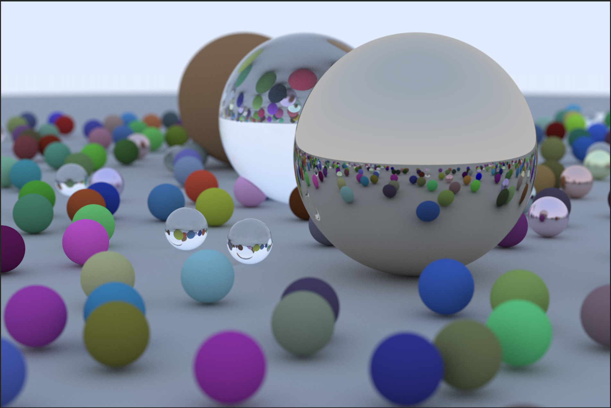

# Ray Tracer (C++)

A physically-based ray tracer built from scratch in C++, following the [Ray Tracing in One Weekend](https://raytracing.github.io) book. No graphics libraries — just math, vectors, and pixels written to a PPM file.

## Render



Hundreds of randomly placed spheres with three material types (matte, metal, and glass), rendered with depth of field and multi-sample anti-aliasing.

## Building

```bash
cmake -B build && cmake --build build

# Render the scene (takes a few minutes)
./build/raytracer > output.ppm

# Open the result
open output.ppm
```

## How it works

For every pixel on the screen, the renderer shoots multiple rays from the camera into the scene. When a ray hits a sphere it bounces off according to that sphere's material, and the process repeats until the ray either escapes to the sky (giving it a color) or bounces too many times. The final pixel color is the average of all those ray samples.

This is called **path tracing**, the same technique used in production renderers like Pixar's RenderMan and Blender's Cycles.

## Materials

**Lambertian (matte):** light scatters randomly in all directions. All the colourful spheres use this. Implemented by picking a random point on a unit sphere attached to the hit point and bouncing the ray toward it.

**Metal:** light reflects at the same angle it arrived, like a mirror. Implemented with the reflection formula `v - 2*dot(v,n)*n`. A `fuzz` parameter adds random scatter for a brushed metal look.

**Dielectric (glass):** light bends as it passes through the surface (refraction) following Snell's law. Uses Schlick's approximation to blend between reflection and refraction depending on viewing angle, which is why glass looks more reflective at shallow angles.

## Features

- `Vec3` class used for positions, directions, and colors (everything is just 3 numbers)
- Ray-sphere intersection via the quadratic formula
- Multi-sample anti-aliasing: multiple rays per pixel, averaged for smooth edges
- Depth of field via thin lens approximation with a configurable aperture
- Randomly generated scene with hundreds of spheres

## What I learned

**The rendering equation.** Each recursive bounce in `ray_color()` computes one term of the rendering equation: how much light arrives at a point from a given direction. Writing it recursively made the physics click.

**Math on paper first.** Every time I tried to code before understanding the derivation (Snell's law refraction, Schlick's approximation) I got it wrong. Writing it out by hand first made the code straightforward.

**Why C++:** Ray tracing is compute-intensive. The final scene takes several minutes in optimised C++. Python would be 10–100x slower, which would make iteration painful.

**Why PPM output:** PPM is the simplest possible image format. Plain text RGB values, no library needed. Once rendered, open it directly in Preview on macOS.
